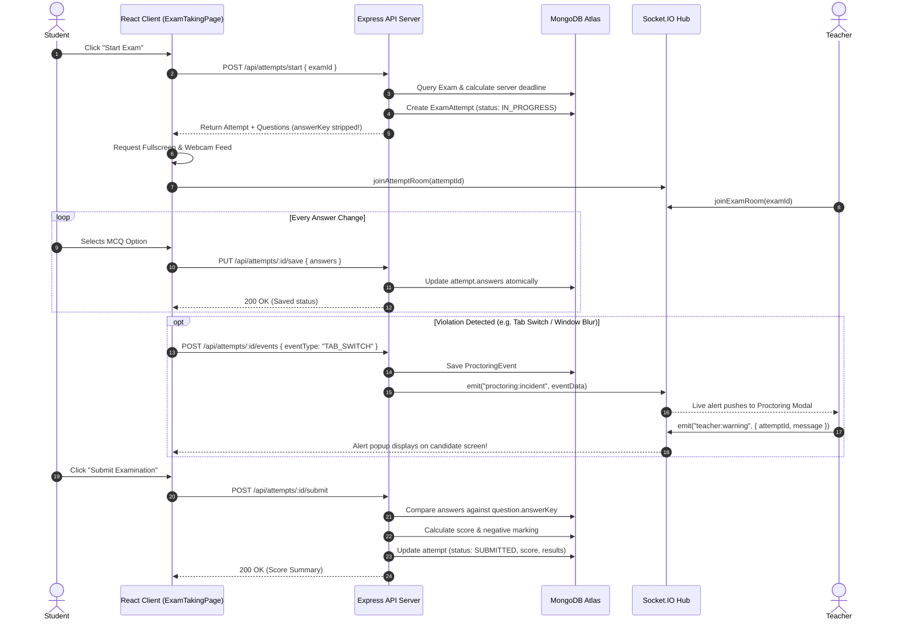
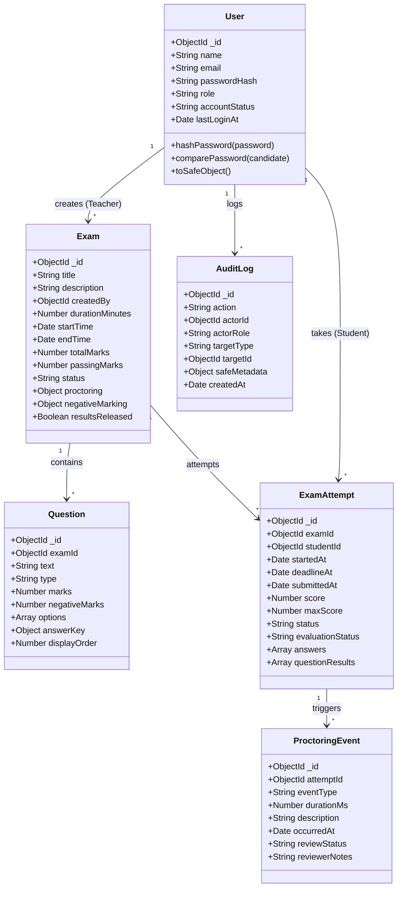
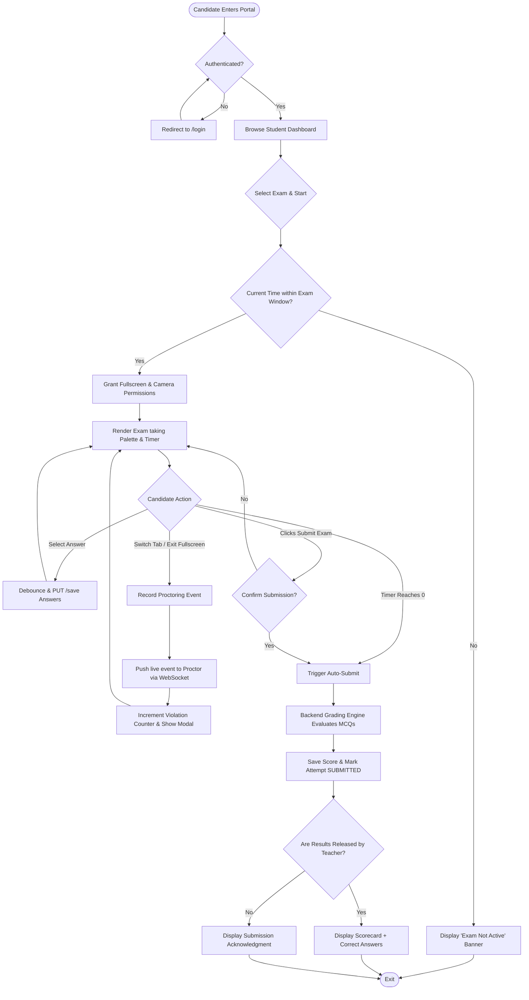
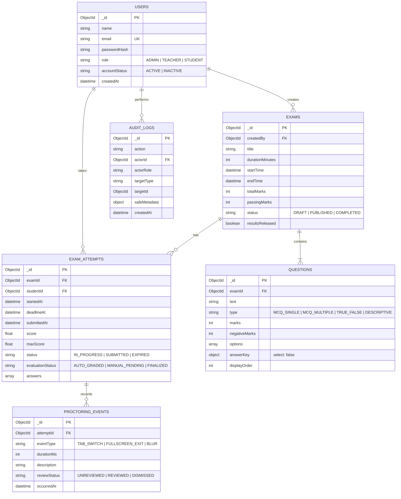

# 🎓 Master Viva Preparation & Project Presentation Guide
## Project: Online Examination & Proctoring System (ExamPortal)

> **Deployment Link:** [https://online-examination-proctoring.vercel.app](https://online-examination-proctoring.vercel.app)  
> **Backend API:** [https://online-examination-proctoring.onrender.com](https://online-examination-proctoring.onrender.com)  
> **Course / Subject:** JavaScript Frameworks (SEM - 5 / Academic Project)

---

# PART I: The 4 Mandatory Academic Deliverables (For Your PPT)

---

## 1. Definition, Objective & Problem Understanding

### 1.1 Project Definition
The **Online Examination & Proctoring System (ExamPortal)** is a full-stack, cloud-native web application developed using the MERN stack (MongoDB, Express.js, React 18 with Vite, and Node.js). It provides a secure, role-based platform that automates the end-to-end examination lifecycle: from multimedia question bank creation and exam scheduling by educators, to browser-locked and webcam-monitored examination sessions for students, followed by real-time fraud telemetry and automated grading.

### 1.2 Core Objectives
1. **Academic Integrity Protection:** Prevent unauthorized external assistance through client-side browser event telemetry (Page Visibility API, Fullscreen Lock API) coupled with floating real-time webcam feed monitoring and Socket.IO proctor broadcasts.
2. **Server-Authoritative Timing:** Eliminate client-side clock tampering by calculating exam deadlines strictly on the backend (`min(startedAt + duration, endTime)`).
3. **Automated Assessment & Instant Feedback:** Automate evaluation of objective question types (Single/Multi-select MCQs, True/False) with configurable negative marking penalties, drastically reducing faculty grading overhead.
4. **Multi-Role Governance:** Provide granular Role-Based Access Control (RBAC) across three distinct actors (**Admin**, **Teacher**, **Student**) with an immutable security audit trail logging every administrative, evaluation, and attempt action.
5. **High Availability & Low Latency:** Architect a stateless, cookie-secured REST API with WebSocket push notifications deployed across global edge networks.

### 1.3 Problem Understanding & Domain Context
* **The Traditional Pen-and-Paper Examination Dilemma:**
  - Physical exam conduct requires substantial logistical expenditure (paper printing, invigilator allocation, venue management).
  - Manual grading is slow, subjective, and prone to human arithmetic errors.
  - Geographical barriers prevent remote or hybrid institutional assessments.
* **The Naive Online Examination Dilemma (The "Unsupervised Tab" Problem):**
  - First-generation online quiz portals allow candidates to open parallel browser tabs, search for answers on search engines, utilize AI assistants (ChatGPT), or manipulate client-side JavaScript timers.
  - Educational institutions either have to pay exorbitant licensing fees for heavyweight desktop lock software (e.g., Safe Exam Browser, ProctorU) or conduct unmonitored exams with compromised academic credibility.
* **Our Solution:** A modern, zero-install, zero-plugin web platform that operates directly within any standard HTML5 browser, offering intelligent proctoring, incremental heartbeat auto-saving (immune to sudden network drops), and granular instructor analytics.

---

## 2. Technical Feasibility Study

A thorough technical feasibility analysis was performed to verify that the required features could be reliably implemented with existing hardware, open-source software libraries, and network infrastructure.

| Dimension | Requirements & Selected Tools | Feasibility Justification |
|---|---|---|
| **Client Environment (Frontend)** | React 18, Vite 8, Tailwind CSS v3, Lucide React, HTML5 Fullscreen & Visibility APIs | Runs smoothly on any standard laptop or mobile browser (Chrome, Edge, Firefox, Safari) without requiring native plugins, extensions, or high CPU usage. |
| **Server Environment (Backend)** | Node.js 20 LTS, Express 5, Socket.IO 4, Helmet 8, Zod 4 | High-concurrency event-driven asynchronous I/O engine capable of handling hundreds of concurrent exam-taking requests with minimal memory footprint (~40MB RAM). |
| **Database System** | MongoDB 7.0 + Mongoose 9 (MongoDB Atlas Cloud M0 Cluster) | Schema flexibility allows polymorphic question structures (MCQ options array vs. text rubric). Subdocument support enables atomic embedding of answers and evaluation records. |
| **Security & Cryptography** | `bcryptjs` (Cost factor 12), `jsonwebtoken` (HMAC-SHA256), `cookie-parser` | Access tokens (15-min expiry) and refresh tokens (7-day expiry) stored in `httpOnly`, `secure`, `sameSite: none` cookies eliminate XSS session hijacking. |
| **Network & Bandwidth** | HTTP/1.1 REST + WSS (WebSockets) | Incremental answer payloads are tiny (< 2 KB per question answer). Video preview is rendered client-side on HTML5 `<video>` canvas, consuming zero server bandwidth for video streaming. |
| **Deployment & Hosting** | Vercel (Edge CDN) + Render.com (Containerized Node.js) + MongoDB Atlas | 100% cost-free, production-grade cloud tier with HTTPS/TLS encryption enabled out-of-the-box. |

---

## 3. Suitable Process Model & Justification

### 3.1 Selected Process Model: **Agile Incremental & Iterative Model**
The project was designed, developed, and tested following the **Agile Iterative Model**, structured across **11 sequential sprint increments**:

```
[Sprint 1: Architecture] ──► [Sprint 2: Auth/RBAC] ──► [Sprint 3: Admin Dashboard]
                                                               │
[Sprint 6: Grading Engine] ◄── [Sprint 5: Student UI] ◄── [Sprint 4: Teacher Exam CRUD]
       │
       ▼
[Sprint 7: Analytics] ──► [Sprint 8 & 9: Proctoring] ──► [Sprint 10: Testing] ──► [Sprint 11: Cloud Deploy]
```

### 3.2 Justification for Chosen Model
1. **Incremental Complexity & Risk Mitigation:** Building a proctoring and exam-taking engine from scratch carries high concurrency and timing risks. Developing the data model and auth first (Sprints 1–3) ensured a rock-solid foundation before tackling complex client-side event listeners and timers (Sprints 4–6).
2. **Early Verification of Core Modules:** Auto-grading and server deadline calculations could be verified independently through Jest unit/integration tests before writing the user-facing modal dialogs.
3. **Iterative Refinement of Security & Proctoring:** Proctoring requirements evolved from simple tab-switch alerts to bidirectional WebSocket alerts (`proctoring:incident` and `student:warning`). Agile sprints allowed seamless incorporation of Socket.IO and NoSQL sanitizers.
4. **Continuous Quality Assurance:** Every sprint ended with automated test runs (17 Jest integration tests + 13 Vitest unit tests) ensuring zero regressions.

---

## 4. Software Analysis & Design Diagrams (UML & ER)

### 4.1 Use Case Diagram

```mermaid
graph TD
    subgraph Actors
        Admin((Admin))
        Teacher((Teacher / Faculty))
        Student((Student / Candidate))
    end

    subgraph ExamPortal System Boundary
        UC1[Register & Authenticate]
        UC2[Manage Platform Users & Roles]
        UC3[Inspect Security Audit Trail]
        UC4[Create & Schedule Exam]
        UC5[Manage Question Bank & Answer Keys]
        UC6[Publish / Archive Exam]
        UC7[Review Submissions & Manual Grading]
        UC8[View Pass Rate & Score Analytics]
        UC9[Monitor Real-time Proctoring Incidents]
        UC10[Issue Proctor Warning to Candidate]
        UC11[Start / Resume Timed Attempt]
        UC12[Auto-Save Incremental Answers]
        UC13[Trigger Fullscreen & Tab Violation Logs]
        UC14[Submit Exam Attempt & Auto-Grade]
        UC15[View Detailed Scorecard & Feedback]
    end

    Admin --> UC1
    Admin --> UC2
    Admin --> UC3

    Teacher --> UC1
    Teacher --> UC4
    Teacher --> UC5
    Teacher --> UC6
    Teacher --> UC7
    Teacher --> UC8
    Teacher --> UC9
    Teacher --> UC10

    Student --> UC1
    Student --> UC11
    Student --> UC12
    Student --> UC13
    Student --> UC14
    Student --> UC15
```



---

### 4.2 Sequence Diagram: Student Exam Taking & Live Proctoring Flow



---

### 4.3 Class Diagram (Core Backend Architecture)



---

### 4.4 Activity Diagram: Exam Taking Lifecycle



---

### 4.5 Entity-Relationship (ER) Diagram



---

# PART II: Master Viva Defense (Top 20 Questions & Answers)

Here are the questions external examiners and professors ask, along with the precise answers you should provide:

### 1. What problem does your project solve that existing solutions like Google Forms or Moodle cannot?
> **Answer:** Standard quiz tools like Google Forms lack proctoring integrity and server-authoritative timekeeping. In Google Forms, students can manipulate client-side system clocks, open adjacent tabs to look up answers, and inspect client HTML to find answers. Our system enforces server-calculated deadlines (`deadlineAt`), continuously monitors tab switches via the HTML5 Page Visibility API and full-screen exits, securely streams incidents in real-time over WebSockets to instructors, and completely strips `answerKey` from outgoing network payloads.

### 2. Why did you choose the MERN stack?
> **Answer:**
> * **Node.js / Express:** Asynchronous, non-blocking event-driven architecture makes it ideal for handling hundreds of concurrent exam-taking heartbeats and WebSocket connections with minimal server memory.
> * **MongoDB / Mongoose:** Examinations are document-oriented. Each question can have varying option structures, and candidate answers are structured as subdocument arrays. Storing this in MongoDB avoids complex multi-table relational joins during high-concurrency exam submissions.
> * **React 18 + Vite:** Fast, dynamic component rendering for the real-time exam palette, timer countdown, and instant modal updates without whole-page refreshes.

### 3. How do you prevent students from seeing the correct answers in the browser's Network tab or DevTools?
> **Answer:** In our Mongoose schema for Questions (`models/Question.js`), the `answerKey` field is defined with `{ select: false }`. When the student calls `POST /api/attempts/start`, our query explicitly runs `.select('-answerKey')`. The correct answer never leaves the server during the examination. It is only compared server-side during the submission endpoint (`/api/attempts/:id/submit`).

### 4. What happens if a student's internet disconnects for 2 minutes during the exam?
> **Answer:** We implemented **incremental auto-saving with heartbeat synchronization** (`useAnswerSync.js`). Every time a student clicks an option, the state updates locally and debounces a `PUT /api/attempts/:id/save` request. If the connection temporarily drops, answers already chosen remain safely in React component state. When the student reconnects and refreshes, `POST /api/attempts/start` detects their existing `IN_PROGRESS` attempt and seamlessly restores all previously saved answers. Furthermore, the exam countdown timer syncs with the server `deadlineAt` timestamp, so no time is stolen or added.

### 5. Why do you use JWT in httpOnly cookies instead of storing tokens in `localStorage`?
> **Answer:** Storing JWTs in `localStorage` makes an application vulnerable to **Cross-Site Scripting (XSS)** attacks—any malicious script injected into the page can access `localStorage.getItem('token')` and steal the session. By storing our JWTs in `httpOnly` cookies, JavaScript in the browser is prohibited from reading the token. Additionally, we set `secure: true` (only sent over HTTPS) and `sameSite: 'none'` in production to safeguard against CSRF while enabling cross-origin requests between Vercel and Render.

### 6. What is the difference between Access Tokens and Refresh Tokens in your project?
> **Answer:** We implemented a dual-token rotation pattern:
> * **Access Token:** Short-lived (15 minutes). Used to authenticate everyday API requests.
> * **Refresh Token:** Long-lived (7 days). Stored securely and only sent to `/api/auth/refresh`. When the 15-minute access token expires, our Axios response interceptor automatically calls `/api/auth/refresh` behind the scenes to obtain a fresh access token without interrupting the candidate's exam session.

### 7. How does the Proctoring Watchdog work technically?
> **Answer:** It uses three browser native APIs:
> 1. **Page Visibility API:** Listens for `visibilitychange` events on `document`. When `document.hidden` becomes true (candidate switches tabs or minimizes browser), an event is dispatched.
> 2. **Window Blur Event:** Listens for `window.onblur` to detect when focus leaves the browser window.
> 3. **Fullscreen API:** Checks `document.fullscreenElement`. If the candidate presses `Esc` or exits full-screen mode, the system immediately flags a violation.
> Every violation is sent to `POST /api/attempts/:id/events` and broadcasted via Socket.IO to the teacher.

### 8. How does Socket.IO work in your application?
> **Answer:** In `server/src/config/socket.js`, we initialize a Socket.IO server on top of the Node HTTP server. We use a **Room-based architecture**:
> * Teachers join an exam room: `socket.join('exam:${examId}')`.
> * Students join an attempt room: `socket.join('attempt:${attemptId}')`.
> When a student triggers a proctoring violation, the controller emits `proctoring:incident` to that specific exam room. The teacher's dashboard receives it instantly without polling. Conversely, the teacher can emit a direct `teacher:warning` message to that candidate's attempt room, triggering an instant warning modal on their screen.

### 9. How do you prevent NoSQL Injection in your backend?
> **Answer:** In `server/src/middleware/sanitize.js`, we implemented custom recursive sanitization middleware that traverses `req.body`, `req.query`, and `req.params`, systematically stripping any object keys containing `$` (e.g. `{"$gt": ""}`) or `.` (dot notation property traversal). This prevents attackers from manipulating Mongoose queries.

### 10. How does the negative marking formula work?
> **Answer:** When an instructor enables negative marking on an exam, they can specify either an exam-wide penalty fraction (e.g., 0.25 for 1/4th penalty) or per-question negative marks. During evaluation in `attempt.controller.js`, if an objective question is answered incorrectly:
> `marksAwarded = -(q.negativeMarks || (q.marks * penaltyFraction))`.
> Total score is clamped to `Math.max(0, totalScore)` so candidates do not receive negative overall scores.

### 11. What is an Error Boundary in React and where did you use it?
> **Answer:** A React Error Boundary is a class component that implements `componentDidCatch` and `getDerivedStateFromError`. In standard React, an unhandled runtime error unmounts the entire component tree, causing a blank white screen. We created `ErrorBoundary.jsx` and wrapped the root `<App />` component in `main.jsx`. If any UI rendering fails, it displays a glassmorphism error card with *"Reload Page"* and *"Go to Home"* options, plus collapsible technical details for debugging.

### 12. How do you evaluate Descriptive or Short Answer questions?
> **Answer:** Objective questions (MCQ Single, MCQ Multiple, True/False) are auto-graded immediately by the backend algorithm upon submission. If an exam contains descriptive questions, the attempt is marked with `evaluationStatus = 'MANUAL_PENDING'`. The teacher accesses the **Submissions Modal**, views the student's text answer, assigns marks and constructive feedback, and updates the attempt to `EVALUATED`.

### 13. What is the purpose of the Audit Log in your system?
> **Answer:** The `AuditLog` collection is an append-only, immutable record for system accountability. Whenever an administrative or sensitive action occurs (e.g., `USER_REGISTERED`, `EXAM_PUBLISHED`, `RESULTS_RELEASED`, `MANUAL_EVALUATION`), the server writes an entry capturing `actorId`, `actorRole`, `action`, `targetId`, and a sanitized metadata snapshot.

### 14. What automated tests did you write?
> **Answer:** We developed a dual testing suite:
> 1. **Backend Integration Tests (Jest + Supertest):** 17 tests in `server/tests/api.test.js` validating the entire server lifecycle: health check, user registration, duplicate prevention, login, JWT cookies, teacher exam CRUD, question creation, publishing, analytics, student attempt creation, answer saving, proctoring events, and auto-grading.
> 2. **Frontend Unit Tests (Vitest + Testing Library):** 13 tests in `client/src/test` validating UI components (Button, Badge, Alert, ErrorBoundary) and utility algorithms (timer countdown formatting, duration calculations, class merger).

### 15. How did you deploy the application to the cloud?
> **Answer:**
> * **Frontend:** Hosted on **Vercel** with a custom `vercel.json` configuring SPA rewrite rules so client-side React routes (`/login`, `/admin/dashboard`) don't throw 404 on page refresh.
> * **Backend:** Containerized via Docker and deployed on **Render.com** with automatic HTTPS and environment variable injection.
> * **Database:** Hosted on a high-availability **MongoDB Atlas M0 Cluster** in AWS with network whitelisting (`0.0.0.0/0`).

### 16. Why did you use Zod for validation instead of simple `if` checks or Joi?
> **Answer:** Zod is a TypeScript-first schema declaration and validation library. It allows us to define strict schemas (e.g. email format, password complexity rules, enum values) and infer types cleanly. In our middleware (`middleware/validate.js`), incoming payloads are validated before reaching the controller. If validation fails, Zod produces structured, user-friendly field-level error messages.

### 17. How is Role-Based Access Control (RBAC) enforced?
> **Answer:** RBAC is enforced on both client and server:
> * **Backend:** Middleware `authorize('ADMIN', 'TEACHER')` checks `req.user.role` extracted from the decoded JWT. If the role doesn't match, it returns HTTP 403 Forbidden.
> * **Frontend:** `ProtectedRoute.jsx` checks the user role in `AuthContext`. If an unauthenticated user attempts access, they are redirected to `/login`; if an unauthorized student attempts to access `/teacher/dashboard`, they are redirected to `/unauthorized`.

### 18. Why did you choose Tailwind CSS instead of a pre-built component library like Bootstrap or Material UI?
> **Answer:** Pre-built component libraries add heavy bundle weight and result in generic-looking interfaces. Tailwind CSS provides utility-first CSS that compiles only the classes actually used, resulting in an ultra-fast production CSS bundle (~52 KB). It allowed us to design a tailored, modern dark-glassmorphism aesthetic with curated HSL color tokens.

### 19. How does Rate Limiting protect the system?
> **Answer:** Using `express-rate-limit`, we established multi-tier rate limiters:
> * `globalLimiter`: 200 requests per minute per IP to protect against general DoS attacks.
> * `authLimiter`: 15 requests per 15 minutes to prevent brute-force password guessing and credential stuffing.
> * `proctoringEventLimiter`: 120 events per minute to prevent telemetry flooding.

### 20. What future enhancements can be added to this system?
> **Answer:**
> 1. AI-powered face detection and gaze tracking using MediaPipe or TensorFlow.js to detect multiple faces or candidate absence without manual instructor inspection.
> 2. Automated audio noise detection via Web Audio API to detect background whispers or speech.
> 3. AI-assisted grading suggestions for descriptive answers using LLM embeddings.

---

# PART III: 10-Slide PPT Presentation Structure (Copy-Paste Ready)

### Slide 1: Title Slide
* **Title:** Online Examination & Proctoring System (ExamPortal)
* **Subtitle:** A Full-Stack MERN Academic Assessment & Integrity Enforcement Platform
* **Presented by:** Ankit Patel
* **Course:** JavaScript Frameworks (Semester 5)
* **Live Demo:** `https://online-examination-proctoring.vercel.app`

### Slide 2: Problem Statement & Objectives
* **Challenges with Existing Systems:** High cost of paper examinations, unchecked tab-switching and AI cheating in naive web portals, manual grading delays.
* **Core Objectives:**
  - Secure browser-locked environment (Fullscreen API & Visibility detection).
  - Server-authoritative countdown timing.
  - Zero-latency auto-grading of objective questions with negative marking.
  - Multi-role role-based governance (Admin, Teacher, Student).

### Slide 3: System Architecture & Tech Stack
* **Frontend:** React 18, Vite 8, Tailwind CSS, Lucide React, Axios.
* **Backend:** Node.js 20, Express 5, Socket.IO (WebSockets), Zod, Helmet.
* **Database:** MongoDB 7 + Mongoose 9 (Cloud MongoDB Atlas).
* **Security:** JWT in `httpOnly` secure cross-site cookies, bcrypt 12, NoSQL sanitization.
* **Deployment:** Vercel (Edge CDN) + Render.com (Docker Web Service).

### Slide 4: Feasibility Study & Process Model
* **Technical Feasibility:** Zero client installation required; operates across modern HTML5 browsers; minimal server resource consumption.
* **Process Model:** Agile Incremental & Iterative Model.
  - Structured across 11 discrete sprint phases.
  - Continuous integration with automated Jest and Vitest suites.
  - High responsiveness to evolving proctoring and security requirements.

### Slide 5: System Analysis (Use Case & ER Diagrams)
* *[Insert Mermaid Use Case & ER Diagrams from Section 4]*
* **Three Primary Actors:**
  - **Admin:** System monitoring, user activation/deactivation, immutable audit logs.
  - **Teacher:** Exam creation, question bank curation, manual evaluation, analytics.
  - **Student:** Timed exam taking, question palette navigation, real-time auto-saving.

### Slide 6: Student Examination & Proctoring Engine
* **Browser Lock:** Continuous monitoring of fullscreen exits and tab switching.
* **Telemetry Broadcast:** Instant Socket.IO transmission of violations to proctor.
* **Timer Security:** Expiration calculated strictly from database `startedAt + duration`.
* **Heartbeat Answer Sync:** Incremental auto-saving resilient to transient network dropouts.

### Slide 7: Automated Grading & Faculty Analytics
* **Objective Evaluation Engine:** Instant grading of single-choice, multi-choice, and True/False questions.
* **Negative Marking Support:** Configurable penalty deductions preventing random guessing.
* **Manual Evaluation Portal:** Faculty grading interface for descriptive questions.
* **Visual Analytics:** Real-time pass rates, score distributions, and question difficulty breakdown.

### Slide 8: Security & Reliability Hardening
* **XSS Prevention:** Tokens isolated in `httpOnly` cookies; zero `localStorage` token storage.
* **NoSQL Injection Defense:** Deep recursive sanitizer stripping `$` and `.` keys.
* **Multi-Tier Throttling:** Specialized rate limiters on authentication and telemetry endpoints.
* **Error Resilience:** React Error Boundary catching runtime UI errors without blank screens.

### Slide 9: Automated Testing & Cloud Deployment
* **Backend Integration Testing:** 17/17 Jest integration tests passing (Auth, Exam CRUD, Auto-grading).
* **Frontend Testing:** 13/13 Vitest unit tests passing (UI components and utilities).
* **Production Build:** Verified Vite bundle (0 errors).
* **Cloud Architecture:** Multi-stage Dockerized backend on Render connected to MongoDB Atlas, reverse-proxied by Vercel global edge.

### Slide 10: Conclusion & Live Demonstration
* **Key Achievements:** Delivered a production-ready, fully accessible examination portal solving real-world academic integrity issues.
* **Live System Demonstration:**
  1. *Admin View:* Live platform metrics & security audit trail.
  2. *Teacher View:* Exam publishing & live proctor watchdog modal.
  3. *Student View:* Taking timed test with webcam preview & auto-grading.
* **Q&A Session:** Ready for panel evaluation.
